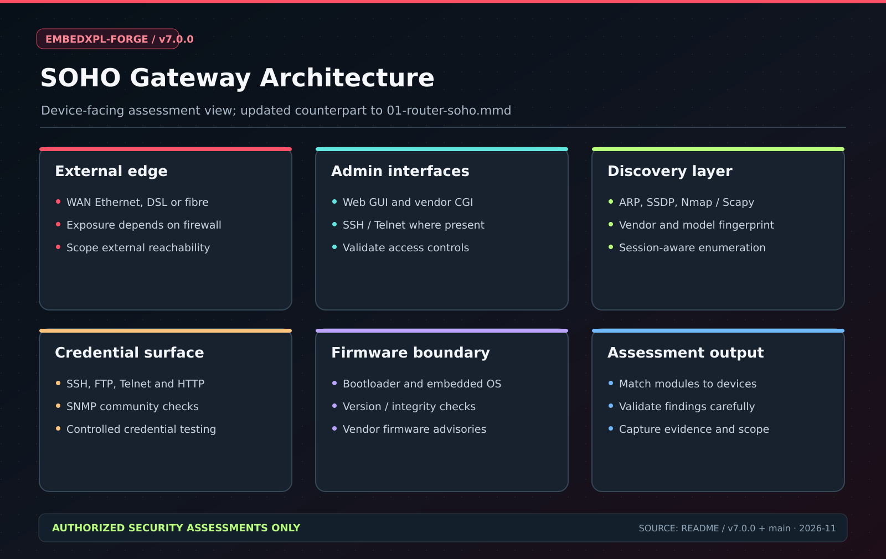
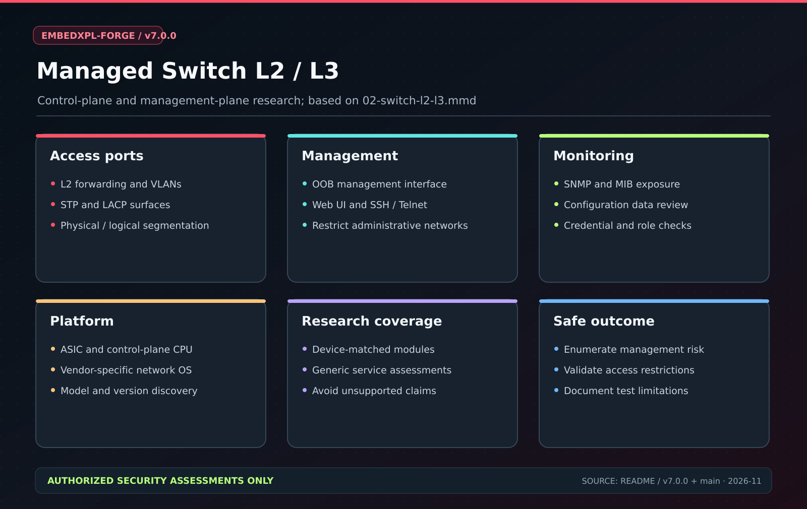
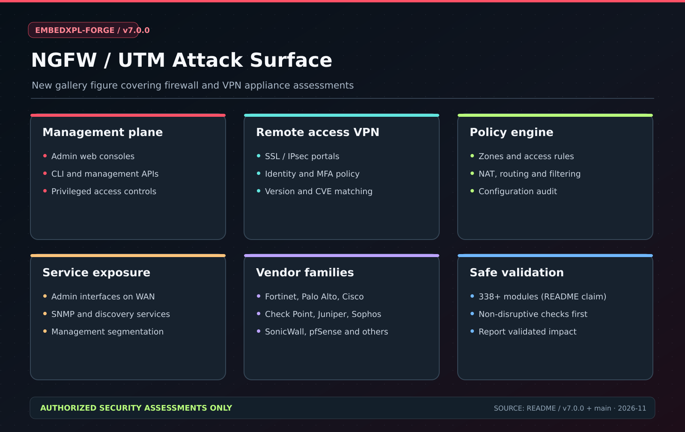
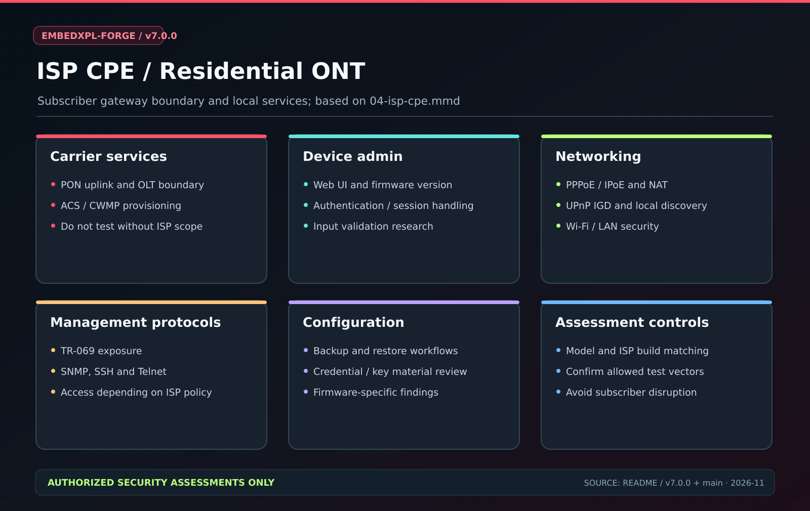
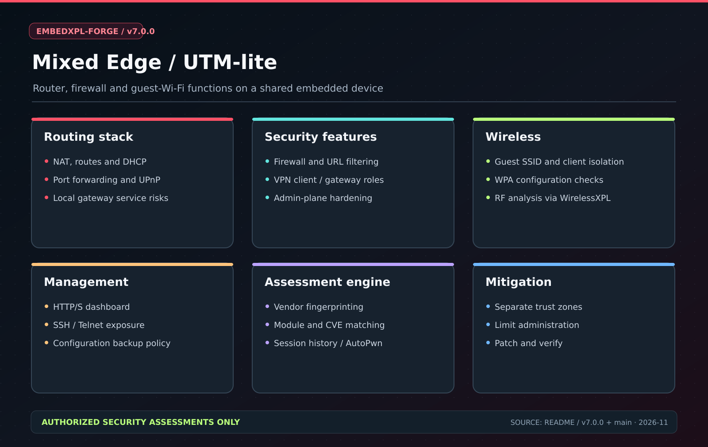
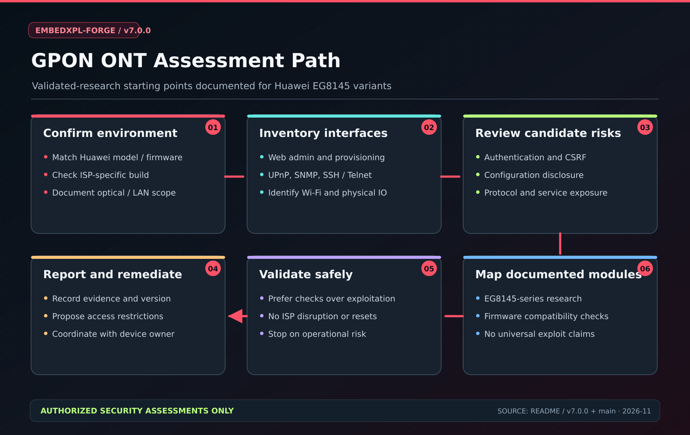

# EmbedXPL-Forge Documentation

**Diagram baseline:** source version `v7.0.0`, aligned with the current `main` documentation (November 2026). Note that the latest published GitHub Release may lag behind the versioned source tag.

## Documentation index

| Location | Description |
|---|---|
| [Wiki](wiki/README.md) | User and module documentation |
| [Architecture diagrams](diagrams/architecture/README.md) | Technical attack-surface maps and editable Mermaid sources |
| [Architecture assets](assets/embedxpl_architecture.svg) | v7 component architecture |
| [Assessment flow](assets/embedxpl_flow.svg) | Authorized assessment lifecycle |
| [Device gallery](img/architecture/README.md) | Device-specific SVG coverage maps |
| [Modules](modules/) | Per-module documentation |

## Device attack-surface gallery

| SOHO Router | L2/L3 Switch |
|:---:|:---:|
|  |  |

| NGFW / UTM | ISP CPE |
|:---:|:---:|
|  |  |

| Mixed Edge | GPON ONT |
|:---:|:---:|
|  |  |

These are architecture and research illustrations, **not proof of exploitability** on a particular device. Match model, firmware, configuration, ROE and scope before any active testing.

## Regeneration of documentation indexes

```bash
python tools/generate_coverage_matrix.py
python tools/generate_full_catalog.py
python tools/gen_wiki_module_index.py
```

The new SVG visual assets are human-curated from the documented v7 capabilities; older PNGs are kept for backward compatibility with external links.
