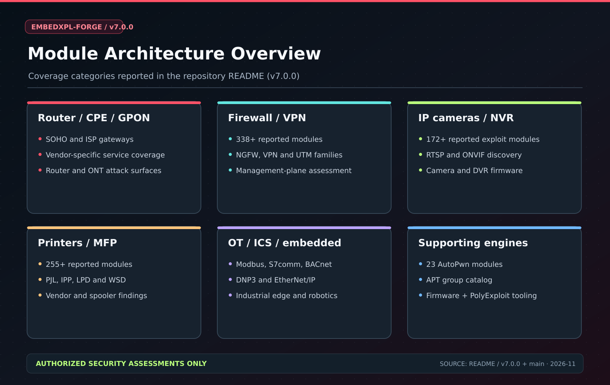
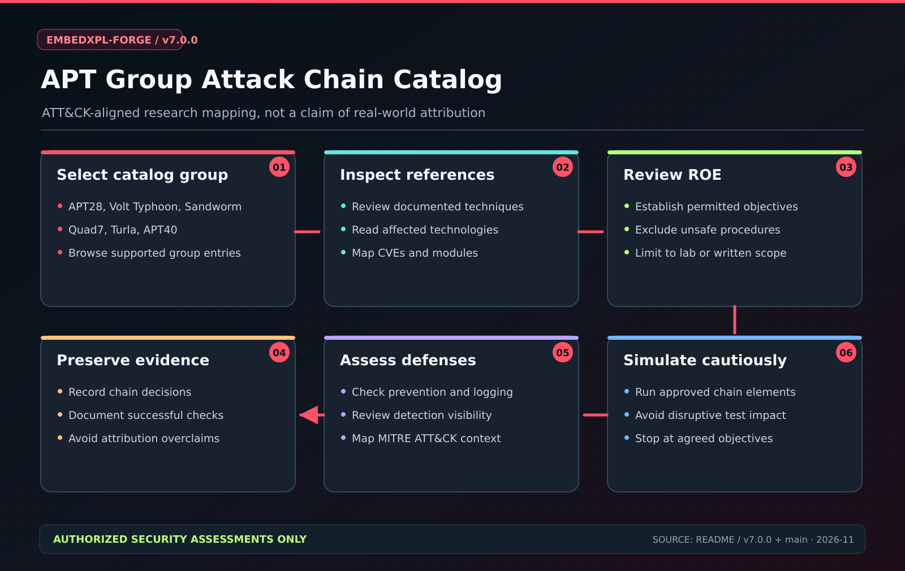
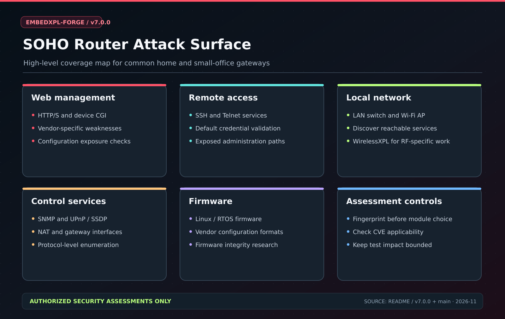
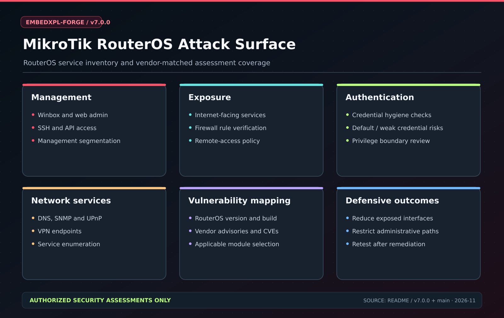
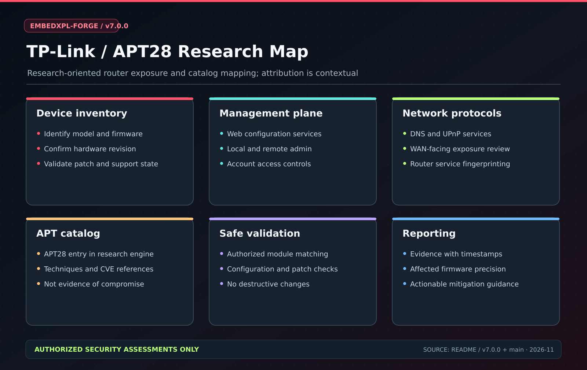
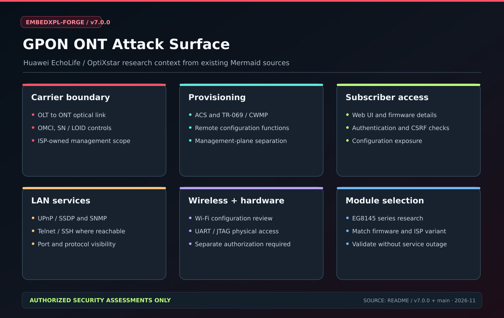

# Architecture Diagrams - EmbedXPL-Forge v7.0.0

These high-resolution SVG diagrams are curated to match the documented version 7 feature set. They summarize **research coverage and assessment surfaces**, not verified vulnerabilities for arbitrary device versions.

## Framework and research diagrams

| Illustration | Current SVG |
|---|---|
| Component architecture | [Open](../../assets/embedxpl_architecture.svg) |
| Authorized assessment flow | [Open](../../assets/embedxpl_flow.svg) |
| Module overview | [Open](exf_arch_overview.svg) |
| APT group research catalog | [Open](exf_arch_apt_chains.svg) |
| SOHO router | [Open](exf_arch_soho_router.svg) |
| TP-Link / APT28 research mapping | [Open](exf_arch_tplink_apt28.svg) |
| MikroTik RouterOS | [Open](exf_arch_mikrotik.svg) |
| GPON ONT | [Open](exf_arch_gpon_ont.svg) |

## Device-specific Mermaid source files

| File | Scope |
|---|---|
| [01-router-soho.mmd](01-router-soho.mmd) | Router / SOHO gateway |
| [02-switch-l2-l3.mmd](02-switch-l2-l3.mmd) | Managed L2/L3 switch |
| [04-isp-cpe.mmd](04-isp-cpe.mmd) | ISP CPE / GPON ONT |
| [05-edge-mixed.mmd](05-edge-mixed.mmd) | Mixed edge / UTM-lite |
| [07-gpon-ont-attack.mmd](07-gpon-ont-attack.mmd) | Huawei EG8145 research |

The legacy Mermaid files preserve detailed research notes and are **not one-to-one exports** of the new overview SVGs. PNGs from earlier versions remain for link compatibility.

## Gallery

| Module architecture | APT research chain |
|:---:|:---:|
|  |  |

| SOHO router | MikroTik |
|:---:|:---:|
|  |  |

| TP-Link research | GPON ONT |
|:---:|:---:|
|  |  |

**Legal note:** Test only devices covered by written authorization, and follow the applicable rules of engagement.
