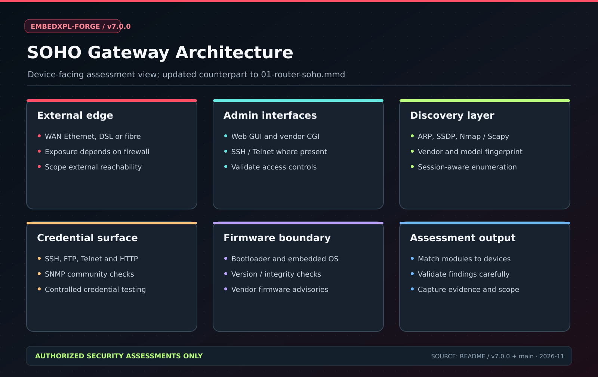
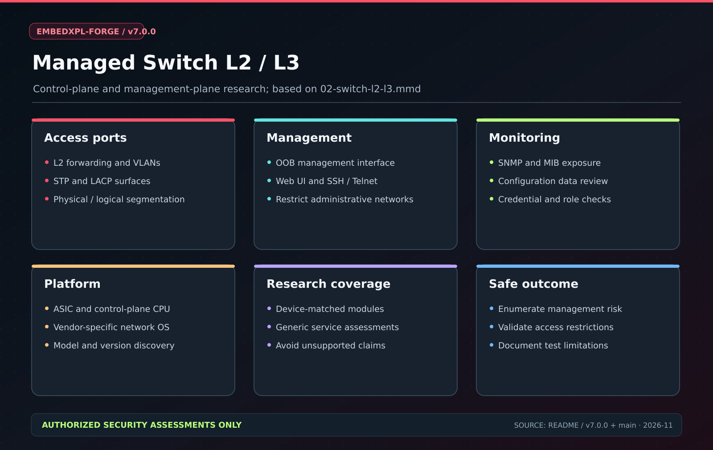
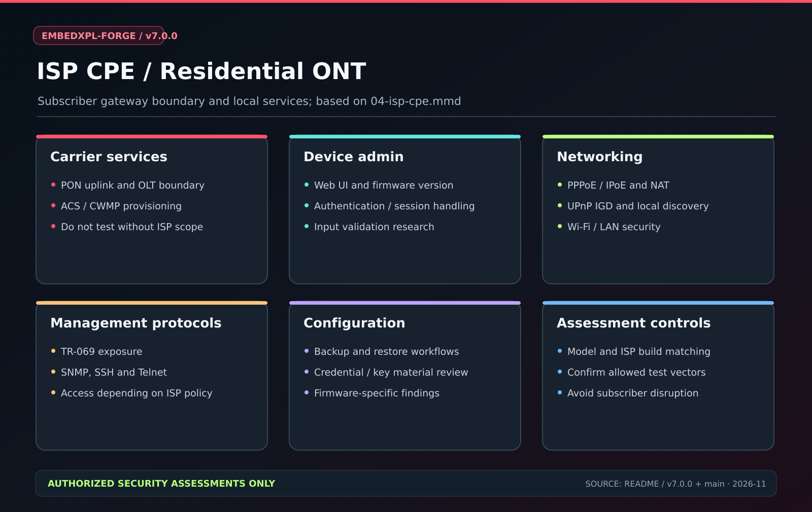
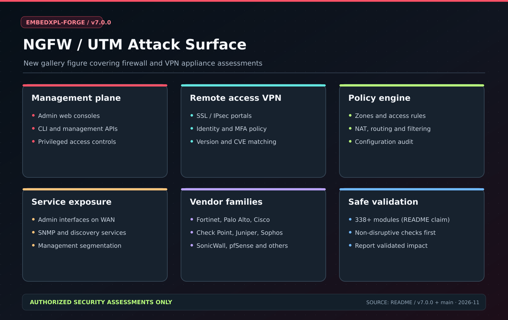
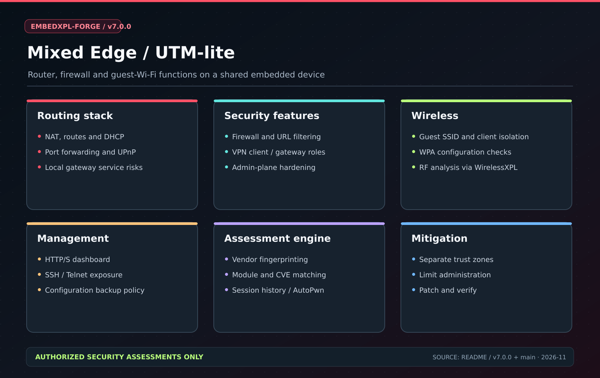

# EmbedXPL-Forge

**Embedded & Perimeter Security Assessment Framework**

{: .warning }
> Use only on systems you own or have **explicit written authorization** to test. Unauthorized use is illegal.

---

## At a glance

| Metric | Value |
|--------|-------|
| Modules | **4,700+** |
| CVEs mapped | **1,475+** (2001–2026) |
| Vendor families | **129+** |
| AutoPwn engines | **23** |
| Python | **3.12 / 3.13 / 3.14** |
| License | **BSD-3-Clause** |

---

## Quick install

```bash
pip install embedxpl
exf
```

Or with [uv](https://github.com/astral-sh/uv) (10× faster):

```bash
uv pip install embedxpl
```

---

## Module categories

| Category | Coverage |
|----------|----------|
| Routers / CPEs | Cisco, D-Link, TP-Link, MikroTik, Netgear, Zyxel, Huawei + 60 more |
| Firewalls / VPNs | Fortinet, Palo Alto, SonicWall, pfSense, Juniper |
| IP Cameras / NVRs | Dahua, Hikvision, Hikvision OEM (Herospeed/Longsee), Intelbras, Sony |
| Printers | HP (PJL/LEDM/LDAP passback), Brother, Canon |
| Smart TVs | Sony Bravia, LG WebOS, Roku ECP, Samsung, TCL, DIAL |
| ICS / OT | Modbus, S7comm, DNP3, EtherNet/IP, BACnet, WDB Agent |
| Wireless / BLE | WPA2/3, BLE scan/enumerate/write (bleak) |
| VxWorks | URGENT/11, WDB agent, version detection |
| NAS | Synology, QNAP, WD My Cloud |
| Generic | SNMP brute, UPnP/SSDP, SSH, Telnet, FTP |

---

## Architecture diagrams

| SOHO Gateway | L2/L3 Switch |
|:---:|:---:|
|  |  |

| ISP CPE / GPON | NGFW / UTM |
|:---:|:---:|
|  |  |

| Mixed Edge |
|:---:|
|  |

→ Full diagram gallery: [Architecture Diagrams](diagrams/architecture/)

---

## Links

- [GitHub Repository](https://github.com/mrhenrike/EmbedXPL-Forge)
- [PyPI Package](https://pypi.org/project/embedxpl/)
- [Contributing](https://github.com/mrhenrike/EmbedXPL-Forge/blob/main/CONTRIBUTING.md)
- [Security Policy](https://github.com/mrhenrike/EmbedXPL-Forge/blob/main/SECURITY.md)
- [Changelog](https://github.com/mrhenrike/EmbedXPL-Forge/blob/main/CHANGELOG.md)
