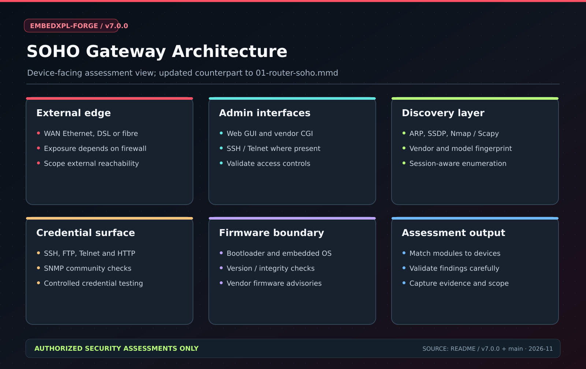
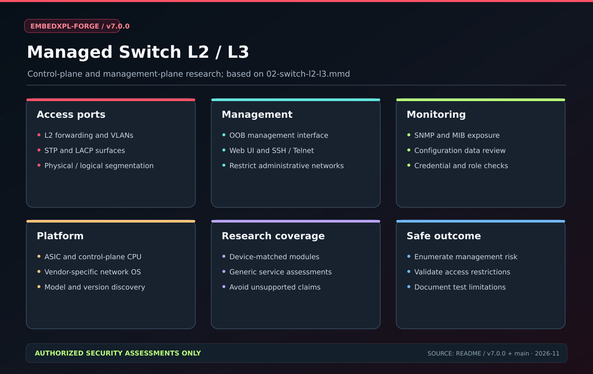
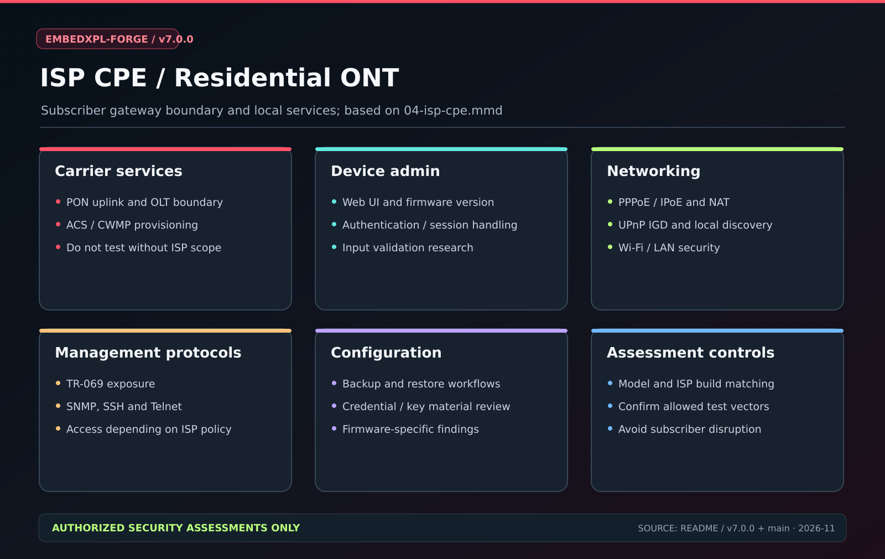
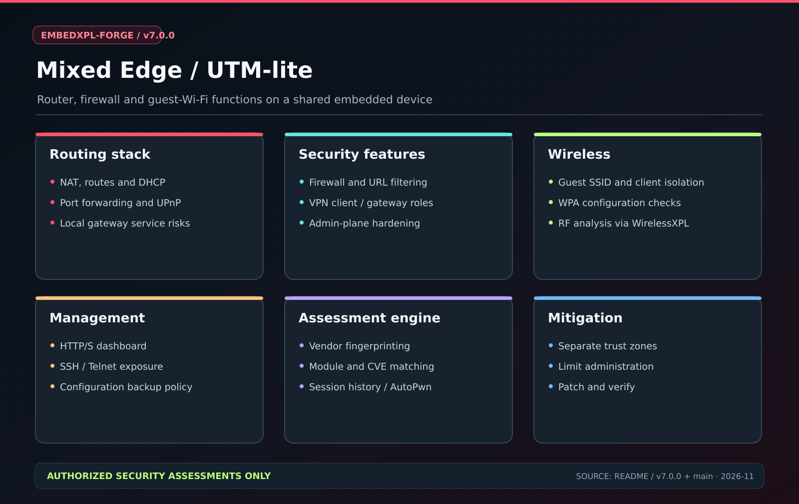
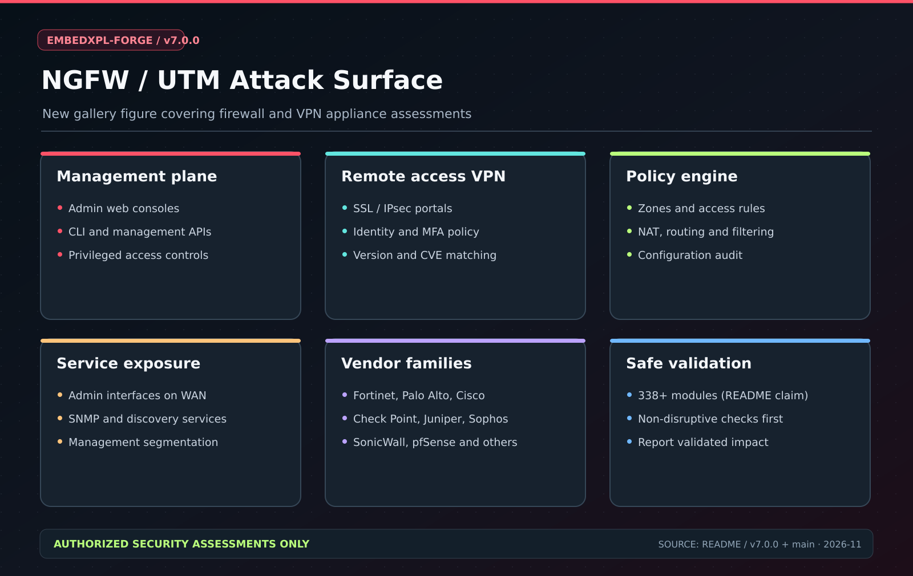
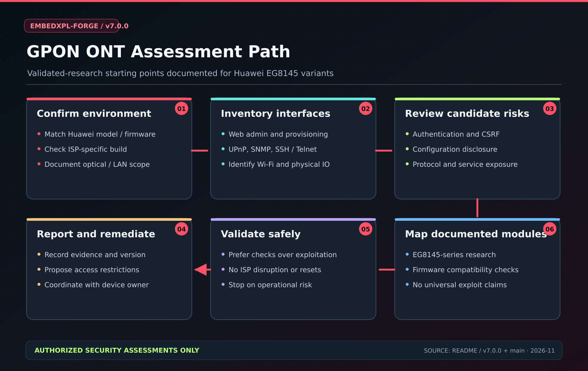

# EmbedXPL-Forge — Wiki

## Documentation

| Locale | Hub |
|--------|-----|
| **English (en-US)** | [en-US/README.md](en-US/README.md) |

## Architecture Diagrams

SVG gallery — [full page](../diagrams/architecture/).

| SOHO Gateway | L2/L3 Switch |
|:---:|:---:|
|  |  |

| ISP CPE / GPON | Mixed Edge |
|:---:|:---:|
|  |  |

| NGFW / UTM | GPON ONT Attack |
|:---:|:---:|
|  |  |

## Governance

| Topic | Link |
|-------|------|
| License | [LICENSE](../../LICENSE) (BSD) |
| Code of Conduct | [CODE_OF_CONDUCT.md](../../CODE_OF_CONDUCT.md) |
| Security | [SECURITY.md](../../SECURITY.md) |
| Contributors | [CONTRIBUTORS.md](../../CONTRIBUTORS.md) |
| Contributing | [CONTRIBUTING.md](../../CONTRIBUTING.md) |

## Repository Root

- [README.md](../../README.md)
- [docs/README.md](../README.md)
